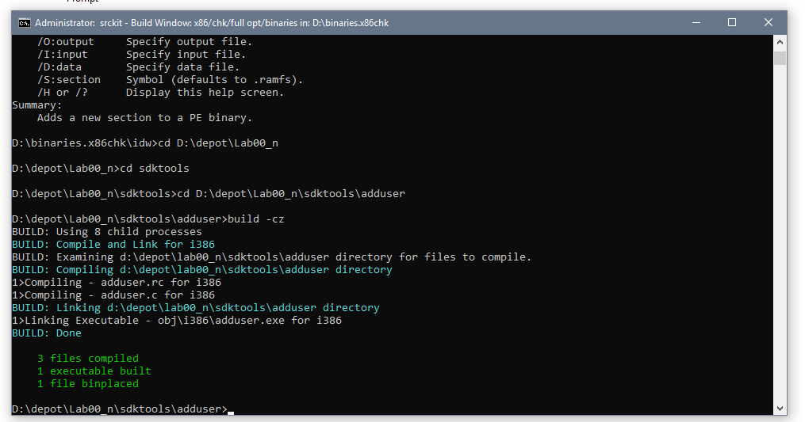

Open the cmd prompt as admin

cd tools

In ntenv.cmd set your PROJDIR INCLUDE and LIB environment varibles, then run razzle.cmd They use VC7 or VC8
which is on my GitHub.

set PROCESSOR_ARCHITECTURE=x86

set msvcdir=J:\MICROSOFT.RESEARCH\Lab00_n\VC8

Simply setting the 2005 VC8 tools and the ENV.BAT and Building the PAL first.

Use the razzle.new to avoid the URT Install and a reinstallation of the Opeteraing System

Build the IDW first in particular the ztools project first with nmake

razzle win32 offline

Supports Windows 10 2019 Enterprise LTSC, USE AT YOU OWN RISK! Works on my Machine.

